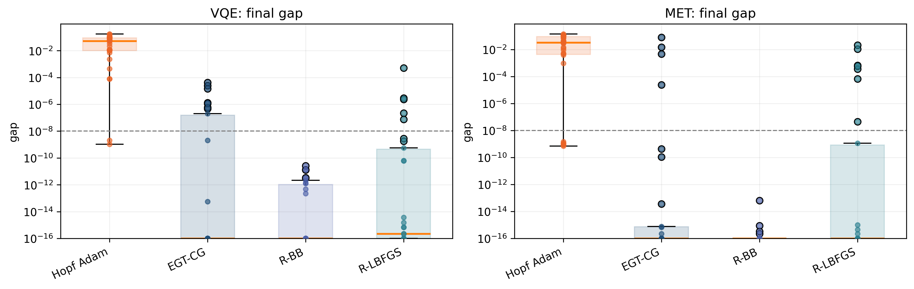
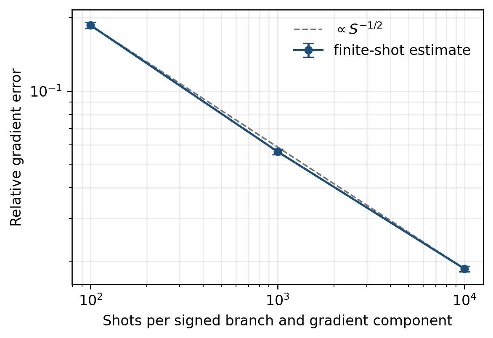
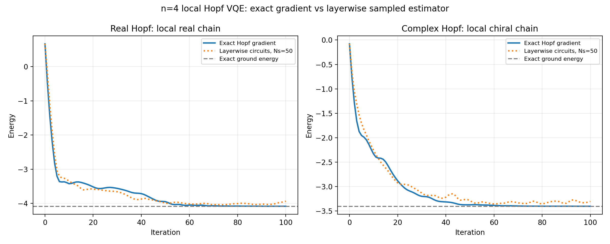

# The Hopf Ansatz

**How can a universal state-preparation circuit also provide coordinates, local geometry, and measurable directions for optimization?** The Hopf ansatz uses one binary tree to prepare arbitrary normalized real and complex state vectors, recover angles from known amplitudes, and expose the metric and coordinate tangents.

**Ruge Lin and Guangxi Li — [A Compass on the Quantum State Sphere: The Hopf Ansatz for Arbitrary Pure-State Optimization](https://arxiv.org/abs/2607.14231) (2026).**

| Result | Scientific meaning |
|---|---|
| Real and complex Hopf charts | A dimension-matched representation of the normalized state-vector sphere, with an explicit amplitude-to-angle inverse |
| Diagonal pullback metric | Subtree probability masses and leaf occupations supply local geometric weights |
| Preparable coordinate tangents | Each nonzero tangent becomes a normalized state on the same circuit skeleton |
| Structured gradient access | Transition moments and signed branches organize derivative access by tree depth and phase family |
| Geometry-aware optimization | The chart supports sphere-based updates and the paper's matched numerical studies |

For $`N=2^n`$, the real chart has $`N-1`$ parameters and the complex chart has $`2N-1`$, retaining the global phase of the state vector. The complex diagonal metric is the ambient round-sphere metric; the real metric agrees with the pullback Fubini–Study metric. Coordinate singularities and the distinction between compiled circuit families and measurement repetitions are part of the scientific account.

## Read the science

The [complete scientific account](science/README.md) contains the paper's main text and every appendix, with original equation, statement, algorithm, figure, table, and reference identifiers. Follow the topic route below, or use the [reviewer crosswalk](review/README.md) to find a specific item from the paper.

| To understand | Read |
|---|---|
| The question and relation to earlier work | [Motivation](science/motivation.md) |
| State preparation, inverse coordinates, and the metric | [Chart and geometry](science/chart-and-geometry.md) and [algorithms](science/algorithms.md) |
| Tangent states, transition moments, and indexed access | [Gradient access](science/gradient-access.md) |
| A complete concrete construction | [Four-qubit example](science/four-qubit-example.md) |
| Jacobians, sphere updates, and optimizer mechanisms | [Geometry-native optimizers](science/optimizers.md) |
| QFI and fixed-readout CFI objectives | [Metrological objectives](science/metrological-objectives.md) |
| Full analytical arguments | [Proofs](science/proofs.md) |
| Numerical comparisons and their interpretation | [Numerical studies](science/numerical-studies.md) and [experimental details](docs/EXPERIMENTS.md) |
| Implementation conventions and API | [Engineering guide](docs/ENGINEERING_GUIDE.md) |

Each result has one scientific home. The engineering guide supplies bit order, angle conventions, boundary handling, and implementation details; [the bibliography](references/paper-bibliography.md) preserves the paper's attribution.

## Learn the project

The single educational anchor is **Michael A. Nielsen and Isaac L. Chuang, _Quantum Computation and Quantum Information_, 10th Anniversary Edition**. The [educational bridge](learning/ANCHOR.md) selects relevant sections, translates conventions, and develops the geometry needed to connect that foundation to this work.

The [30-milestone map](learning/MILESTONES.md) contains **12 background/preliminaries milestones and 18 narrative/innovation milestones**. Both phases progress from local objects and mechanisms to the complete scientific story. Every milestone has an understanding target, dependencies, a conceptual connection, and source links.

## Verify and reproduce

Start with the [reviewer route](review/README.md): paper item → full statement and proof → implementation → executable check. The [reproduction guide](verification/README.md) gives environment setup, commands, data generation, figure reproduction, and expected results.

Use Python 3.10 or newer. From the repository root:

```bash
python -m venv .venv
source .venv/bin/activate
python -m pip install -r requirements.txt
python hopf_utils.py
```

Install `requirements-optional.txt` for the explicit Qibo circuit checks. The small checks exercise coordinate maps, metrics, tangents, and logical gate schedules; the full experiments regenerate the numerical studies. General analytical statements are established by their written proofs.

<p align="center">
  
  
  
</p>

These supplementary implementation figures are described in [Experiments and evidence](docs/EXPERIMENTS.md); the original paper figures appear with their captions in the scientific account.

## Companion paper

[Hopf-QBP](https://github.com/GoGoKo699/Hopf-QBP) develops shared finite-shot records for the complete Hopf-coordinate gradient. Its paper is [Compass in the Mirror: Quantum Backpropagation with the Hopf Ansatz](https://arxiv.org/abs/2610.14177). The repositories use the same educational anchor and reading structure and are independently runnable.

## Citation

**Ruge Lin and Guangxi Li, “A Compass on the Quantum State Sphere: The Hopf Ansatz for Arbitrary Pure-State Optimization,” arXiv:2607.14231 (2026).**

```bibtex
@misc{lin2026hopf,
  title = {A Compass on the Quantum State Sphere: The Hopf Ansatz for Arbitrary Pure-State Optimization},
  author = {Lin, Ruge and Li, Guangxi},
  year = {2026},
  eprint = {2607.14231},
  archivePrefix = {arXiv},
  primaryClass = {quant-ph},
  url = {https://arxiv.org/abs/2607.14231}
}
```

Machine-readable citation metadata is available in [CITATION.cff](CITATION.cff).

## Purpose and contact

This repository serves as a record of the work and a guide for the author’s self-directed learning. For discussion or potential collaboration, please contact Ruge Lin at [gogoko699@gmail.com](mailto:gogoko699@gmail.com).

## License

The software is released under the [MIT License](LICENSE). The scientific account identifies the authors and the arXiv source of the paper.
