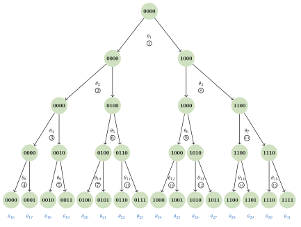
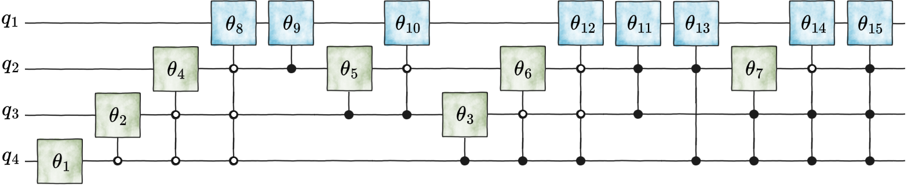

[Scientific text](README.md) · [Reviewer route](../review/README.md) · [Repository](../README.md)

<a id="A2"></a>

# Appendix B A four-qubit example of the Hopf ansatz

This appendix gives the $`n=4`$ real and complex Hopf ansatze as reference examples for the notation, tables, and circuit diagrams. We write

<a id="A2.Ex51"></a>

```math
N=2^{4}=16,\qquad\ell=(q_{4}q_{3}q_{2}q_{1})_{2}\in\{0,\ldots,15\},
```

with qubits ordered from most significant $`q_{4}`$ to least significant $`q_{1}`$. The real ansatz has internal-node parameters

<a id="A2.Ex52"></a>

```math
\theta_{1},\ldots,\theta_{15},
```

and the complex ansatz adds leaf phases

<a id="A2.Ex53"></a>

```math
\theta_{16+\ell},\qquad\ell=0,\ldots,15.
```

The tree, gate schedule, metric table, and layerwise derivative circuits use the same indexing convention; Fig. [3](four-qubit-example.md#A2.F3) is the reference diagram.

<a id="A2.SSx1"></a>

## Hopf tree and leaf-phase indexing

Figure [3](four-qubit-example.md#A2.F3) shows the complete $`n=4`$ Hopf tree. At each internal node $`j`$, a bit-$`0`$ branch contributes $`\cos\theta_{j}`$, while a bit-$`1`$ branch contributes $`\sin\theta_{j}`$. Define

<a id="A2.Ex54"></a>

```math
f_{0}(\theta):=\cos\theta,\qquad f_{1}(\theta):=\sin\theta.
```

For a leaf $`\ell=(q_{4}q_{3}q_{2}q_{1})_{2}`$, let

<a id="A2.Ex55"></a>

```math
s_{1}(\ell)=1,\qquad s_{t+1}(\ell)=2s_{t}(\ell)+q_{5-t},\quad t=1,2,3.
```

Its path amplitude is

<a id="A2.E48"></a>

```math
{a_{\ell}=\prod_{t=1}^{4}f_{q_{5-t}}\!\left(\theta_{s_{t}(\ell)}\right),\qquad x_{\ell}^{\mathbb{R}}=a_{\ell},\qquad x_{\ell}^{\mathbb{C}}=a_{\ell}e^{\mathrm{i}\theta_{16+\ell}},}\tag{B1}
```

with the corresponding real or complex angle ranges.

For example, the first leaf follows the all-left path, the last leaf follows the all-right path, and the intermediate leaf $`10=(1010)_{2}`$ follows the right–left–right–left path:

<a id="A2.EGx2"></a>

```math
\begin{aligned}x_{0}^{\mathbb{R}} & =\cos\theta_{1}\cos\theta_{2}\cos\theta_{4}\cos\theta_{8}, & x_{0}^{\mathbb{C}} & =x_{0}^{\mathbb{R}}e^{\mathrm{i}\theta_{16}},\end{aligned}
```

<a id="A2.E49"></a>

```math
{\begin{aligned}x_{10}^{\mathbb{R}} & =\sin\theta_{1}\cos\theta_{3}\sin\theta_{6}\cos\theta_{13}, & x_{10}^{\mathbb{C}} & =x_{10}^{\mathbb{R}}e^{\mathrm{i}\theta_{26}},\end{aligned}}\tag{B2}
```

```math
\begin{aligned}x_{15}^{\mathbb{R}} & =\sin\theta_{1}\sin\theta_{3}\sin\theta_{7}\sin\theta_{15}, & x_{15}^{\mathbb{C}} & =x_{15}^{\mathbb{R}}e^{\mathrm{i}\theta_{31}}.\end{aligned}
```

The general $`n`$-qubit formula is given in Lemma [3](proofs.md#Thmlemma3).

<a id="A2.F3"></a>



Figure 3: Binary tree for preparing a $`4`$-qubit state in Hopf coordinates. A bit-$`0`$ branch multiplies the amplitude by $`\cos\theta_{j}`$, and a bit-$`1`$ branch multiplies it by $`\sin\theta_{j}`$. The displayed $`\theta_{j}`$ labels are the Hopf magnitude parameters associated with internal nodes, while the blue labels $`\theta_{16},\ldots,\theta_{31}`$ are the complex leaf phases. Circled numbers indicate the gate-application order generated by Algorithms [1](algorithms.md#algorithm-1) and [2](algorithms.md#algorithm-2). The binary labels inside the nodes are padded path labels identifying the corresponding subtree or leaf, rather than the breadth-first internal-node indices.

<a id="A2.SSx2"></a>

## Ansatz circuit

The tree in Fig. [3](four-qubit-example.md#A2.F3) determines both the amplitude products and the physical gate schedule. Each internal node becomes one controlled single-qubit rotation. In the real ansatz, this is an $`R_{y}`$ gate. In the complex ansatz, only the final-layer rotations are promoted to $`R_{\mathbb{C}}`$ gates, because they split sibling leaves and can therefore attach the two corresponding leaf phases.

<a id="A2.F4"></a>



Figure 4: <a id="A2.F4.4"></a>

Four-qubit Hopf ansatz circuit derived from the tree in Fig. [3](four-qubit-example.md#A2.F3). The green gates are the magnitude rotations shared by the real-state and complex-state versions of the Hopf ansatz. In the complex ansatz, each final-layer gate $`\theta_{j}`$ with $`8\leq j\leq 15`$ is promoted to an $`R_{\mathbb{C}}`$ gate carrying the magnitude angle $`\theta_{j}`$ and the two sibling leaf phases listed in Table [I](four-qubit-example.md#A2.T1). All quantum circuit diagrams in this work were produced using the quantum-circuit-drawio-library [[54](../references/paper-bibliography.md#bib.bib47)].

<a id="A2.T1"></a>

| Order | $`\mathtt{Ctrl}`$ | $`\mathtt{Anti}`$ | $`\mathtt{Targ}`$ | $`\mathtt{Index}`$ (real) | Gates (real) | $`\mathtt{Index}`$ (complex) | Gates (complex) |
| --- | --- | --- | --- | --- | --- | --- | --- |
| 1 | $`0000`$ | $`0000`$ | $`1000`$ | $`1`$ | $`R_{y}^{4}(\theta_{1})`$ | $`1`$ | $`R_{y}^{4}(\theta_{1})`$ |
| 2 | $`0000`$ | $`1000`$ | $`0100`$ | $`2`$ | $`a_{4}R_{y}^{3}(\theta_{2})`$ | $`2`$ | $`a_{4}R_{y}^{3}(\theta_{2})`$ |
| 3 | $`0000`$ | $`1100`$ | $`0010`$ | $`4`$ | $`a_{3,4}R_{y}^{2}(\theta_{4})`$ | $`4`$ | $`a_{3,4}R_{y}^{2}(\theta_{4})`$ |
| 4 | $`0000`$ | $`1110`$ | $`0001`$ | $`8`$ | $`a_{2,3,4}R_{y}^{1}(\theta_{8})`$ | $`[8,16,17]`$ | $`a_{2,3,4}R_{\mathbb{C}}^{1}(\theta_{8},\theta_{16},\theta_{17})`$ |
| 5 | $`0010`$ | $`0000`$ | $`0001`$ | $`9`$ | $`c_{2}R_{y}^{1}(\theta_{9})`$ | $`[9,18,19]`$ | $`c_{2}R_{\mathbb{C}}^{1}(\theta_{9},\theta_{18},\theta_{19})`$ |
| 6 | $`0100`$ | $`0000`$ | $`0010`$ | $`5`$ | $`c_{3}R_{y}^{2}(\theta_{5})`$ | $`5`$ | $`c_{3}R_{y}^{2}(\theta_{5})`$ |
| 7 | $`0100`$ | $`0010`$ | $`0001`$ | $`10`$ | $`c_{3}a_{2}R_{y}^{1}(\theta_{10})`$ | $`[10,20,21]`$ | $`c_{3}a_{2}R_{\mathbb{C}}^{1}(\theta_{10},\theta_{20},\theta_{21})`$ |
| 8 | $`1000`$ | $`0000`$ | $`0100`$ | $`3`$ | $`c_{4}R_{y}^{3}(\theta_{3})`$ | $`3`$ | $`c_{4}R_{y}^{3}(\theta_{3})`$ |
| 9 | $`1000`$ | $`0100`$ | $`0010`$ | $`6`$ | $`c_{4}a_{3}R_{y}^{2}(\theta_{6})`$ | $`6`$ | $`c_{4}a_{3}R_{y}^{2}(\theta_{6})`$ |
| 10 | $`1000`$ | $`0110`$ | $`0001`$ | $`12`$ | $`c_{4}a_{2,3}R_{y}^{1}(\theta_{12})`$ | $`[12,24,25]`$ | $`c_{4}a_{2,3}R_{\mathbb{C}}^{1}(\theta_{12},\theta_{24},\theta_{25})`$ |
| 11 | $`0110`$ | $`0000`$ | $`0001`$ | $`11`$ | $`c_{2,3}R_{y}^{1}(\theta_{11})`$ | $`[11,22,23]`$ | $`c_{2,3}R_{\mathbb{C}}^{1}(\theta_{11},\theta_{22},\theta_{23})`$ |
| 12 | $`1010`$ | $`0000`$ | $`0001`$ | $`13`$ | $`c_{2,4}R_{y}^{1}(\theta_{13})`$ | $`[13,26,27]`$ | $`c_{2,4}R_{\mathbb{C}}^{1}(\theta_{13},\theta_{26},\theta_{27})`$ |
| 13 | $`1100`$ | $`0000`$ | $`0010`$ | $`7`$ | $`c_{3,4}R_{y}^{2}(\theta_{7})`$ | $`7`$ | $`c_{3,4}R_{y}^{2}(\theta_{7})`$ |
| 14 | $`1100`$ | $`0010`$ | $`0001`$ | $`14`$ | $`c_{3,4}a_{2}R_{y}^{1}(\theta_{14})`$ | $`[14,28,29]`$ | $`c_{3,4}a_{2}R_{\mathbb{C}}^{1}(\theta_{14},\theta_{28},\theta_{29})`$ |
| 15 | $`1110`$ | $`0000`$ | $`0001`$ | $`15`$ | $`c_{2,3,4}R_{y}^{1}(\theta_{15})`$ | $`[15,30,31]`$ | $`c_{2,3,4}R_{\mathbb{C}}^{1}(\theta_{15},\theta_{30},\theta_{31})`$ |

Table I: Circuit synthesis from Algorithms [1](algorithms.md#algorithm-1) and [2](algorithms.md#algorithm-2). Control, anti-control, and target qubit locations are encoded as bitmasks in $`\mathtt{Ctrl}`$, $`\mathtt{Anti}`$, and $`\mathtt{Targ}`$ (a ‘$`1`$’ denotes an active qubit). Throughout, we order qubits as $`(q_{n},\ldots,q_{1})`$ from left to right in bitmasks. Thus, for $`n=4`$, $`\mathtt{Targ}=1000`$ targets qubit $`4`$ and $`\mathtt{Targ}=0001`$ targets qubit $`1`$. For the complex ansatz, an integer index denotes a magnitude-only $`R_{y}`$ gate, while a length-three index denotes a promoted $`R_{\mathbb{C}}`$ gate carrying one magnitude angle and two leaf phases.

With the gate order and index convention fixed, we return to the same tree as a coordinate chart. A single root-to-leaf path gives an amplitude product; differentiating that product gives the sparse Jacobian row; and the squared probability flowing through each internal node gives the corresponding diagonal metric entry.

<a id="A2.SSx3"></a>

## Metric and Jacobian entries

As a representative path calculation, consider the leaf $`\ell=10=(1010)_{2}`$. Reading the bits from $`q_{4}`$ to $`q_{1}`$, the path takes the bit sequence $`1,0,1,0`$. Hence the path uses the factors $`\sin\theta_{1}`$, $`\cos\theta_{3}`$, $`\sin\theta_{6}`$, and $`\cos\theta_{13}`$, giving

<a id="A2.E50"></a>

```math
{x_{10}=\sin\theta_{1}\cos\theta_{3}\sin\theta_{6}\cos\theta_{13}.}\tag{B3}
```

The corresponding nonzero real Jacobian entries in the row for $`x_{10}`$ are

<a id="A2.E51"></a>

```math
{\frac{\partial x_{10}}{\partial\theta_{1}}=\cot\theta_{1}\,x_{10},\quad\frac{\partial x_{10}}{\partial\theta_{3}}=-\tan\theta_{3}\,x_{10},\quad\frac{\partial x_{10}}{\partial\theta_{6}}=\cot\theta_{6}\,x_{10},\quad\frac{\partial x_{10}}{\partial\theta_{13}}=-\tan\theta_{13}\,x_{10}.}\tag{B4}
```

In the complex ansatz,

<a id="A2.E52"></a>

```math
{x_{10}^{\mathbb{C}}=x_{10}e^{\mathrm{i}\theta_{26}},\qquad\frac{\partial x_{10}^{\mathbb{C}}}{\partial\theta_{26}}=\mathrm{i}\,x_{10}^{\mathbb{C}}.}\tag{B5}
```

The same tree also gives the metric entries. For an internal node $`j`$, the real metric entry $`g^{\mathbb{R}}_{j,j}`$ is the squared amplitude weight accumulated along the path from the root to the parent of $`j`$. Let

<a id="A2.Ex58"></a>

```math
c_{j}:=\cos^{2}\theta_{j},\qquad s_{j}:=\sin^{2}\theta_{j}.
```

Then the diagonal real Hopf metric for $`n=4`$ is listed in Table [II](four-qubit-example.md#A2.T2). In the complex ansatz, the magnitude block has the same entries, while each phase direction is weighted by the occupation probability of its leaf:

<a id="A2.Ex59"></a>

```math
g^{\mathbb{C}}_{j,j}=g^{\mathbb{R}}_{j,j}\quad(1\leq j\leq 15),\qquad g^{\mathbb{C}}_{16+\ell,16+\ell}=\vert x_{\ell}\vert ^{2}.
```

<a id="A2.T2"></a>

| $`j`$ | Prefix | $`g^{\mathbb{R}}_{j,j}`$ | $`j`$ | Prefix | $`g^{\mathbb{R}}_{j,j}`$ |
| --- | --- | --- | --- | --- | --- |
| 1 | $`\emptyset`$ | $`1`$ | 9 | $`001`$ | $`c_{1}c_{2}s_{4}`$ |
| 2 | $`0`$ | $`c_{1}`$ | 10 | $`010`$ | $`c_{1}s_{2}c_{5}`$ |
| 3 | $`1`$ | $`s_{1}`$ | 11 | $`011`$ | $`c_{1}s_{2}s_{5}`$ |
| 4 | $`00`$ | $`c_{1}c_{2}`$ | 12 | $`100`$ | $`s_{1}c_{3}c_{6}`$ |
| 5 | $`01`$ | $`c_{1}s_{2}`$ | 13 | $`101`$ | $`s_{1}c_{3}s_{6}`$ |
| 6 | $`10`$ | $`s_{1}c_{3}`$ | 14 | $`110`$ | $`s_{1}s_{3}c_{7}`$ |
| 7 | $`11`$ | $`s_{1}s_{3}`$ | 15 | $`111`$ | $`s_{1}s_{3}s_{7}`$ |
| 8 | $`000`$ | $`c_{1}c_{2}c_{4}`$ |  |  |  |

Table II: Diagonal metric entries for the real $`n=4`$ Hopf ansatz. The prefix is the length-$`d_{j}`$ binary expansion of $`j-2^{d_{j}}`$, padded with leading zeros.

The metric entries in Table [II](four-qubit-example.md#A2.T2) are precisely the normalization factors for coordinate derivatives. Dividing a raw derivative by $`\sqrt{g_{j,j}}`$ removes the amplitude weight accumulated before node $`j`$, leaving a normalized state supported only on the subtree rooted at $`j`$. We now spell this out for two magnitude parameters and one phase parameter.

<a id="A2.SSx4"></a>

## Representative normalized coordinate tangents

First, consider the magnitude parameter $`\theta_{5}`$. Its subtree contains the leaves $`\{4,5,6,7\}`$. To distinguish the two ansatze in these examples, write $`\lvert \psi_{\mathbb{R}}(\boldsymbol{\theta})\rangle`$ and $`\lvert \psi_{\mathbb{C}}(\boldsymbol{\theta})\rangle`$ for the real and complex Hopf states, respectively.

For the real ansatz, after normalization by $`\sqrt{g^{\mathbb{R}}_{5,5}}=\sqrt{c_{1}s_{2}}`$, all factors from the path above node $`5`$ cancel, and the normalized coordinate tangent is supported only on that subtree:

<a id="A2.E53"></a>

```math
{\lvert e^{\mathbb{R}}_{5}(\boldsymbol{\theta})\rangle =\sum_{\ell=4}^{7}v^{(5,\mathbb{R})}_{\ell}\lvert b_{\ell}\rangle ,}\tag{B6}
```

where

<a id="A2.E54"></a>

```math
{(v^{(5,\mathbb{R})}_{4},v^{(5,\mathbb{R})}_{5},v^{(5,\mathbb{R})}_{6},v^{(5,\mathbb{R})}_{7})=(-\sin\theta_{5}\cos\theta_{10},-\sin\theta_{5}\sin\theta_{10},\cos\theta_{5}\cos\theta_{11},\cos\theta_{5}\sin\theta_{11}).}\tag{B7}
```

For the complex ansatz, the magnitude factors are the same, but the inherited leaf phases on the subtree must be kept:

<a id="A2.E55"></a>

```math
{\lvert e^{\mathbb{C}}_{5}(\boldsymbol{\theta})\rangle =\sum_{\ell=4}^{7}v^{(5,\mathbb{C})}_{\ell}\lvert b_{\ell}\rangle ,}\tag{B8}
```

where

<a id="A2.E56"></a>

<a id="A2.E56X"></a>

```math
{\begin{aligned}(v^{(5,\mathbb{C})}_{4},v^{(5,\mathbb{C})}_{5},v^{(5,\mathbb{C})}_{6},v^{(5,\mathbb{C})}_{7})=(-\sin\theta_{5}\cos\theta_{10}e^{\mathrm{i}\theta_{20}},-\sin\theta_{5}\sin\theta_{10}e^{\mathrm{i}\theta_{21}},\ \ \cos\theta_{5}\cos\theta_{11}e^{\mathrm{i}\theta_{22}},\ \cos\theta_{5}\sin\theta_{11}e^{\mathrm{i}\theta_{23}}).\end{aligned}}\tag{B9}
```

As a final-layer magnitude example, the parameter $`\theta_{13}`$ splits only the sibling leaves $`\ell=10`$ and $`\ell=11`$. For the real ansatz, after normalization by $`\sqrt{g^{\mathbb{R}}_{13,13}}=\sqrt{s_{1}c_{3}s_{6}}`$, the normalized tangent is

<a id="A2.E57"></a>

```math
{\lvert e^{\mathbb{R}}_{13}(\boldsymbol{\theta})\rangle =-\sin\theta_{13}\lvert b_{10}\rangle +\cos\theta_{13}\lvert b_{11}\rangle .}\tag{B10}
```

For the complex ansatz, the corresponding magnitude tangent keeps the two leaf phases:

<a id="A2.E58"></a>

```math
{\lvert e^{\mathbb{C}}_{13}(\boldsymbol{\theta})\rangle =-\sin\theta_{13}e^{\mathrm{i}\theta_{26}}\lvert b_{10}\rangle +\cos\theta_{13}e^{\mathrm{i}\theta_{27}}\lvert b_{11}\rangle .}\tag{B11}
```

For a phase parameter, the tangent is supported on a single leaf. In particular, $`\theta_{26}=\theta_{16+10}`$ is attached to $`\ell=10`$, so on the regular set where $`g^{\mathbb{C}}_{26,26}=\vert x_{10}\vert ^{2}\gt 0`$,

<a id="A2.E59"></a>

```math
{\lvert e^{\mathbb{C}}_{26}(\boldsymbol{\theta})\rangle =\mathrm{i}e^{\mathrm{i}\theta_{26}}\lvert b_{10}\rangle .}\tag{B12}
```

Table [III](four-qubit-example.md#A2.T3) lists representative gate assignments that synthesize these normalized directions using the same Hopf gate skeleton. These assignments are physical gate settings and may lie outside the canonical coordinate ranges. All unspecified magnitude angles are set to zero; in complex rows, all unspecified phase angles are also set to zero.

<a id="A2.T3"></a>

| Target direction | Nonzero or kept assignments | Support |
| --- | --- | --- |
| $`\lvert e^{\mathbb{R}}_{5}\rangle`$ | $`\theta^{(5)}_{1}=0`$, $`\theta^{(5)}_{2}=\pi/2`$, $`\theta^{(5)}_{5}=\theta_{5}+\pi/2`$; $`\theta^{(5)}_{10}=\theta_{10}`$, $`\theta^{(5)}_{11}=\theta_{11}`$ | $`\ell=4,5,6,7`$ |
| $`\lvert e^{\mathbb{C}}_{5}\rangle`$ | $`\theta^{(5)}_{1}=0`$, $`\theta^{(5)}_{2}=\pi/2`$, $`\theta^{(5)}_{5}=\theta_{5}+\pi/2`$; $`\theta^{(5)}_{10}=\theta_{10}`$, $`\theta^{(5)}_{11}=\theta_{11}`$; $`\theta^{(5)}_{20}=\theta_{20}`$, $`\theta^{(5)}_{21}=\theta_{21}`$, $`\theta^{(5)}_{22}=\theta_{22}`$, $`\theta^{(5)}_{23}=\theta_{23}`$ | $`\ell=4,5,6,7`$ |
| $`\lvert e^{\mathbb{R}}_{13}\rangle`$ | $`\theta^{(13)}_{1}=\pi/2`$, $`\theta^{(13)}_{3}=0`$, $`\theta^{(13)}_{6}=\pi/2`$, $`\theta^{(13)}_{13}=\theta_{13}+\pi/2`$ | $`\ell=10,11`$ |
| $`\lvert e^{\mathbb{C}}_{13}\rangle`$ | $`\theta^{(13)}_{1}=\pi/2`$, $`\theta^{(13)}_{3}=0`$, $`\theta^{(13)}_{6}=\pi/2`$, $`\theta^{(13)}_{13}=\theta_{13}+\pi/2`$; $`\theta^{(13)}_{26}=\theta_{26}`$, $`\theta^{(13)}_{27}=\theta_{27}`$ | $`\ell=10,11`$ |
| $`\lvert e^{\mathbb{C}}_{26}\rangle`$ | $`\theta^{(26)}_{1}=\pi/2`$, $`\theta^{(26)}_{3}=0`$, $`\theta^{(26)}_{6}=\pi/2`$, $`\theta^{(26)}_{13}=0`$, $`\theta^{(26)}_{26}=\theta_{26}+\pi/2`$ | $`\ell=10`$ |

Table III: Representative gate assignments that synthesize normalized coordinate tangents in the $`n=4`$ example. The rows distinguish real magnitude tangents from complex magnitude tangents; the latter keep the original leaf phases on the relevant subtree, as required by Theorem [3](gradient-access.md#Thmtheorem3).

The preceding examples prepare one tangent direction at a time. The layerwise construction batches all tangent directions at the same tree depth by adding an index register. The $`d=2`$ layer is the first nontrivial four-label example in the $`n=4`$ ansatz, so it is the natural case to display explicitly.

<a id="A2.SSx5"></a>

## Layerwise derivative and branch circuits

For depth $`d=2`$, the magnitude layer is $`\mathcal{L}_{2}=\{4,5,6,7\}`$. A two-qubit index register labels the offset within this layer. We write the register as $`I_{1}I_{2}`$, with $`I_{1}`$ the most significant label bit, so the four computational-basis labels select the four tangent assignments as follows:

<a id="A2.E60"></a>

```math
{00\mapsto\theta_{4},\qquad 01\mapsto\theta_{5},\qquad 10\mapsto\theta_{6},\qquad 11\mapsto\theta_{7}.}\tag{B13}
```

<a id="A2.F5"></a>


Figure 5: Indexed derivative preparation for the $`d=2`$ magnitude layer of the four-qubit real Hopf ansatz. The index register $`I_{1}I_{2}`$ selects one of the tangent-state assignments $`\boldsymbol{\theta}^{(j)}`$ with $`j\in\{4,5,6,7\}`$ according to Eq. ([B13](four-qubit-example.md#A2.E60)). Conditioned on the observed index, the system register is in the corresponding normalized coordinate tangent.

<a id="A2.F6"></a>


Figure 6: Indexed signed-branch preparation for the same $`d=2`$ magnitude layer. The branch $`a=0`$ prepares the baseline state $`\mathrm{HopfReal}(\boldsymbol{\theta})\lvert 0\rangle ^{\otimes 4}`$, while the branch $`a=1`$ prepares the index-selected tangent state $`\mathrm{HopfReal}(\boldsymbol{\theta}^{(j)})\lvert 0\rangle ^{\otimes 4}`$. Measuring $`a`$ in the $`X`$ basis, equivalently by adding a Hadamard before $`Z`$-basis readout, yields the signed branch states used in the estimator.
