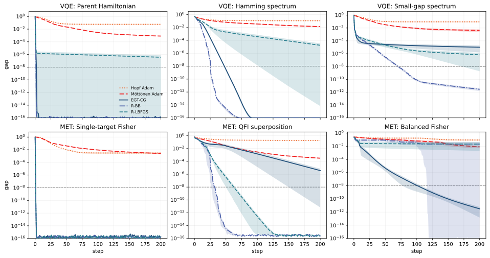

[Scientific text](README.md) · [Reviewer route](../review/README.md) · [Repository](../README.md)

# IV Numerical simulations

This section evaluates how Hopf geometry affects optimizer performance. All runs are deterministic real-Hopf state-vector simulations: each step evaluates the objective and first derivatives exactly from the current state. This matches the analytic optimizer layer of Appendix [C](optimizers.md#A3) and tests updates using the diagonal Hopf metric, state-sphere geodesics, and vector transport. Convergence panels use optimizer step as the horizontal axis; aggregate panels group task-size-seed traces by application class and optimizer.

Hopf coordinates inherit spherical-coordinate boundary cases: zero subtree weight makes some angles nonunique, and $`g_{i,i}=0`$ marks directions outside the regular tangent chart. Appendix [A](algorithms.md#A1) fixes the inverse-map convention. In the real-state simulations, accepted states are mapped back through this inverse with angle clipping ($`10^{-6}`$ for non-final angles and $`10^{-9}`$ near final-layer sign singularities); gradients use a boundary-safe tree contraction and a $`10^{-12}`$-floored state-gradient lift.

The main comparison is between three Hopf-geometric optimizers from Appendix [C](optimizers.md#A3) and two coordinate-Adam baselines. All five methods use the same stress instances and deterministic cost-and-gradient information. The distinction is how that information is used: EGT-CG, R-BB, and R-LBFGS update through the state-sphere geometry induced by the analytic diagonal metric, while the Adam baselines update coordinates directly.

Hopf-EGT-CG (exact geodesic transport with conjugate gradients) implements the update of Ref. [[24](../references/paper-bibliography.md#bib.bib2)] in the Hopf circuit chart. Hopf-Riemannian-BB uses a Riemannian Barzilai–Borwein spectral-gradient step [[38](../references/paper-bibliography.md#bib.bib51)], with transported two-point secant information setting the step scale. Hopf-Riemannian-LBFGS applies a limited-memory quasi-Newton update on the state sphere [[39](../references/paper-bibliography.md#bib.bib49), [40](../references/paper-bibliography.md#bib.bib50)]. Across all three methods, the analytic diagonal metric maps coordinate gradients to state-sphere gradients, the sphere exponential map generates normalized trial states, and the inverse Hopf map returns accepted states to circuit angles.

The two Adam baselines are included as coordinate reference methods [[41](../references/paper-bibliography.md#bib.bib54)]. Hopf-Adam applies Adam directly to the Hopf coordinates, using the same exact Hopf-coordinate gradient as EGT-CG, R-BB, and R-LBFGS. It isolates the effect of using the Hopf chart without the induced-metric and state-sphere update layer. Möttönen-ideal-PS-Adam (“PS” denotes parameter shift) applies Adam to the physical post-multiplexing $`R_{y}`$ angles of the real Möttönen state-preparation circuit [[13](../references/paper-bibliography.md#bib.bib11)]. Its gradient is the exact parameter-shift-equivalent gradient in those physical angles. Both Adam baselines use adaptive cost-only backtracking for trial steps. Thus all methods use the same task instances, iteration budget, and cost-plus-gradient information interface, while differing in how the coordinate information is converted into update directions.

## Stress-test design

The benchmarks are designed to emphasize optimizer behavior rather than problem-specific structure. Each task is scrambled by a fixed real orthogonal circuit, so the optimum is a generic real state in the computational basis. We run five system sizes, $`n=6,7,8,9,10`$, and record $`201`$ states per run, including the initial state at step zero. For each fixed task instance we use ten deterministic pseudo-random initial-state seeds. Thus, for each application class and each optimizer, the aggregate contains $`5\text{ (system sizes)}\times 3\text{ (tasks)}\times 10\text{ (seeds)}=150`$ optimization traces. The scrambling circuit and objective are fixed for a given task; the additional seeds test sensitivity to the initial variational state rather than generating new Hamiltonians or new metrological objectives.

The VQE stress tests are:

- **Parent Hamiltonian:** $`H=I-\lvert \tau\rangle \!\langle \tau\rvert`$, where $`\lvert \tau\rangle`$ is a scrambled target state. The optimal energy gap is zero.

- **Scrambled Hamming spectrum:** a normalized diagonal Hamming-distance spectrum is conjugated by the real scrambling circuit. The unique ground state is again a scrambled basis state.

- **Small-gap scrambled spectrum:** a scrambled diagonal Hamiltonian with one ground state, one nearby excited state separated by a gap $`10^{-2}`$, and all other levels at unit energy.

The metrology-inspired stress tests are:

- **Single-target Fisher objective:** a fixed-readout proxy with $`F=\langle\tau\vert \rho\vert \tau\rangle^{2}`$, minimized as $`1-F`$.

- **QFI extremal-superposition objective:** a scrambled diagonal generator whose optimum is an equal superposition of the extremal generator eigenstates. The cost is one minus the normalized pure-state QFI.

- **Balanced two-target Fisher objective:** a nonlinear soft-min objective that rewards simultaneous overlap with two scrambled target states. The optimum is reached when the two target Fisher contributions are balanced.

VQE panels show energy gaps; metrology panels show Fisher or normalized-QFI optimality gaps, with lower values better throughout. Roundoff-level negative final values are clipped to a positive floor on logarithmic axes. All scheduled task-size-seed traces were included in the aggregate statistics.

Figure 1:  Aggregate final precision and threshold hitting over all stress tests and system sizes $`n=6,\ldots,10`$. The top row shows final optimality gaps after $`200`$ accepted updates; the gray dashed line marks the $`10^{-8}`$ reference threshold. The bottom row shows the first accepted update at which each crossing trace reaches that threshold; the parenthetical labels report the number crossing within $`200`$ updates out of the total number of traces. In every box plot, the box spans the interquartile range, the horizontal line marks the median, and the whiskers extend to the most extreme values within $`1.5`$ interquartile ranges. Colored circles are the individual task-size-seed traces. Optimizer colors are used consistently in this figure and Fig. [2](numerical-studies.md#S4.F2): orange for Hopf-Adam, red for Möttönen-ideal-PS-Adam, dark blue for EGT-CG, indigo for R-BB, and teal for R-LBFGS. Lower values are better. The metric-aware Hopf methods concentrate near the numerical floor in VQE and have numerical-precision medians in the metrology-inspired aggregate; their main distinction is the size of the slow-convergence tail.

Figure 2:  Per-task convergence at $`n=10`$, with ten deterministic pseudo-random initial-state seeds per task. The top row shows the parent-Hamiltonian, scrambled-Hamming-spectrum, and small-gap-spectrum VQE tasks. The bottom row shows the single-target Fisher, QFI extremal-superposition, and balanced two-target Fisher tasks. Each curve is the mean optimality gap across the ten seeds, and each translucent band is the corresponding standard error of the mean. Optimizer colors match Fig. [1](numerical-studies.md#S4.F1), and the legend’s line styles are used consistently in all six panels. The gray dashed line marks the $`10^{-8}`$ reference threshold. The vertical scale is logarithmic and lower values are better. Because several metric-aware traces reach the plotting floor, these panels are primarily per-task convergence diagnostics; the final-gap and threshold-hit distributions are summarized in Fig. [1](numerical-studies.md#S4.F1).

## Aggregate results

We first summarize aggregate final precision, then turn to per-task convergence. Figure [1](numerical-studies.md#S4.F1) summarizes the aggregate behavior over all $`150`$ traces in each application class. For the three metric-aware Hopf optimizers, we also report pairwise comparisons: a “final win” means a method achieved the smallest final gap on a given trace, a “best-gap win” means it achieved the smallest gap at any step, and the mean final rank is the average rank (1–3) of its final gap across all traces. Across both VQE and metrology-inspired tests, EGT-CG, R-BB, and R-LBFGS have numerical-precision median final gaps. The meaningful distinctions therefore appear in the mean final gap, final-rank statistics, threshold-hitting behavior, and the size of the slow-convergence tail.

For VQE, the metric-aware Hopf optimizers reach much smaller final gaps than the coordinate Adam baselines. Hopf-Riemannian-BB gives the smallest mean final VQE gap, $`1.61\times 10^{-12}`$, with median final gap $`1.02\times 10^{-25}`$, $`66`$ final wins, and mean final rank $`1.63`$ among EGT-CG, R-BB, and R-LBFGS. Hopf-EGT-CG is close in median performance, with median final gap $`1.02\times 10^{-25}`$ and $`55`$ final wins. It also obtains the largest number of best-gap wins, $`75`$, but its mean final gap, $`9.23\times 10^{-6}`$, is larger because a small tail of runs converges more slowly. Hopf-Riemannian-LBFGS also reaches near-machine-precision median accuracy, with median final gap $`5.30\times 10^{-17}`$, but has the weakest mean final gap, $`3.21\times 10^{-5}`$, and the largest mean rank among the three VQE Hopf-geometric optimizers. For comparison, the stronger VQE coordinate baseline, Möttönen-ideal-PS-Adam, has mean final gap $`3.47\times 10^{-3}`$ and median $`7.35\times 10^{-4}`$; Hopf-Adam has mean final gap $`7.01\times 10^{-2}`$. These coordinate baselines therefore remain several orders of magnitude above the best Hopf-geometric mean final gap. Hopf-Adam separates the effect of the Hopf coordinates themselves from the effect of the metric-aware state-sphere update.

The metrology-inspired tests show a different geometry-sensitive pattern from the VQE aggregate. The three metric-aware Hopf optimizers have roundoff-scale median final gaps: $`0`$ for Hopf-EGT-CG, $`1.67\times 10^{-16}`$ for Hopf-Riemannian-LBFGS, and $`0`$ for Hopf-Riemannian-BB. Their mean final gaps are instead set by slow or stalled tails: $`1.56\times 10^{-3}`$, $`2.36\times 10^{-3}`$, and $`5.74\times 10^{-3}`$, respectively. On the same aggregate, Möttönen-ideal-PS-Adam has a comparable mean final gap, $`1.53\times 10^{-3}`$, but a larger median, $`3.67\times 10^{-4}`$. Thus the mean gaps are similar on these tests, while the distributions differ: EGT-CG, R-BB, and R-LBFGS place more traces at numerical precision, whereas Möttönen-ideal-PS-Adam retains a larger typical residual. Hopf-Adam remains the weakest coordinate baseline, with mean final metrology gap $`7.96\times 10^{-2}`$.

Within the metric-aware Hopf family, the metrology-inspired tests do not identify a single uniformly dominant method. Hopf-EGT-CG gives the smallest mean final metrological gap, $`1.56\times 10^{-3}`$, and the largest number of best-gap wins, $`66`$. Hopf-Riemannian-BB has the strongest rank-based behavior, with the best mean final rank, $`1.81`$, but its mean final gap is $`5.74\times 10^{-3}`$ because of a larger outlier tail. Hopf-Riemannian-LBFGS has median final gap $`1.67\times 10^{-16}`$ and mean final gap $`2.36\times 10^{-3}`$, but it has the fewest final wins, the fewest best-gap wins, and the weakest mean final rank within the metrology aggregate.

## Per-task convergence

Figure [2](numerical-studies.md#S4.F2) shows where the aggregate differences arise at $`n=10`$. The parent-Hamiltonian and single-target Fisher objectives are the easiest tasks: most Hopf-geometric traces rapidly reach the target scale. On the Hamming, small-gap, QFI, and balanced Fisher tasks, the mean curves often overlap after the fast initial descent, so the important differences are the slow tails and the traces that fail to cross the $`10^{-8}`$ threshold within $`200`$ accepted iterations. The balanced two-target Fisher objective is the most diagnostic nonlinear test, especially for identifying such slow-tail behavior.

These results attribute the observed advantage to optimizer-side use of the Hopf-induced geometry. The real Hopf ansatz supplies the state family, while the per-update behavior reflects the diagonal Hopf metric, state-sphere geodesics, and vector transport. Hopf-Adam provides the corresponding coordinate-space reference by using the same coordinates and coordinate gradients with a generic coordinate update. The remaining differences among BB, EGT-CG, and L-BFGS are optimizer-level robustness differences within a common Hopf coordinate-and-metric framework.
